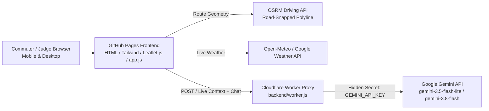

# 🚌 SmartTransit Tamil Nadu — Next-Gen Transit & Fare Engine

**Live Demo:** [https://rangaaaww.github.io/smarttransit-tamilnaduu/](https://rangaaaww.github.io/smarttransit-tamilnaduu/)

SmartTransit Tamil Nadu is a real-time multimodal transit, dynamic fare-comparison, and live **Gemini AI** commuter copilot built for Chennai and Tamil Nadu. It empowers daily commuters to beat dynamic ride-hailing surges (rain & night pricing) by comparing live **Rapido, Auto, and Uber** fares against official **zero-surge Tamil Nadu Government MTC & TNSTC bus tariffs**.

---

## 🎯 Problem & Solution

* **The Problem:** During Chennai monsoons or late-night hours (10 PM – 5 AM), ride-hailing apps surge by **1.25x to 1.65x+**, while commuters lack a single unified interface that shows live bus movement, official stage-wise government fares, and instant bilingual (English/Tamil) route guidance.
* **The Solution:** SmartTransit TN combines **OSRM road-snapped live bus tracking**, **live weather & automatic night-fare modeling**, **official G.O. Ms No. 42 MTC stage tariffs**, and a **floating transparent Gemini AI Assistive Ball** that answers route, fare, and bus questions in **English or Tamil** (via text or voice) with zero API key setup required for end users.

---

## ✨ Key Features

* **🤖 Floating Transparent Gemini AI Copilot (`EN / தமிழ்` + Voice):** A draggable, frosted-glass Assistive Ball that works seamlessly on mobile and desktop. Powered by **Gemini 3.5 Flash-Lite / 3.8 Flash** via a secure serverless proxy, grounded in the user's live origin, destination, weather, night surge, and active bus data.
* **🗺️ Road-Snapped Live Bus Tracking:** Uses **Leaflet.js + OSRM** driving geometry to animate buses along actual Chennai roads at realistic city pace (~22 km/h) with passed/upcoming stop timelines.
* **🌦️ Live Weather & Automatic Night Surge Engine:** Pulls live Chennai weather via **Open-Meteo** (with optional Google Weather API support) and automatically applies **10 PM – 5 AM Night Fare rules** (1.5x Auto, 1.25x Rapido, 1.35x Uber) — plus a one-click **`🌙 Test Night`** preview toggle for judges.
* **🏛️ Official TN Govt MTC Stage Fares:** Implements **G.O. Ms No. 42** Ordinary, Express, and Deluxe stage slabs, including **₹0 Women Free Travel** (Ordinary/Pink buses) and **50% Student Concession**.
* **🛡️ Passenger Safety & SOS Hub:** One-tap access to TN Police (`100/112`), Ambulance (`108`), Women Helpline (`181`), and MTC Safety Cell (`149`), alongside NCMC digital pass view, favorites, and search history.

---

## 🏗️ System Architecture

### 🔒 API Key Security Architecture
To prevent client-side credential leaks on a public GitHub Pages deployment, the Gemini API key is **never stored in frontend code**. All AI requests are routed through a **Cloudflare Worker (`backend/worker.js`)** where `GEMINI_API_KEY` is stored as an encrypted runtime secret, allowing unlimited judges and commuters to use the live AI immediately without entering personal keys.

---

## 🛠️ Tech Stack

* **AI & Backend Proxy:** Google Gemini API (`gemini-3.5-flash-lite`, `gemini-3.8-flash`), Cloudflare Workers
* **Frontend & UI:** HTML5, Tailwind CSS, Glassmorphic Responsive UI, Web Speech API (Voice Input)
* **Maps & Live Data:** Leaflet.js, Google Map Tiles, OSRM Routing Engine, Open-Meteo Weather API

---

## 👥 Team

* **Sadhan H M** (`310625104302`) — Backend & Architecture
* **Ranganathan P** (`310625104285`) — AI / ML & Systems

*Department of Computer Science and Engineering, Easwari Engineering College, Chennai.*
